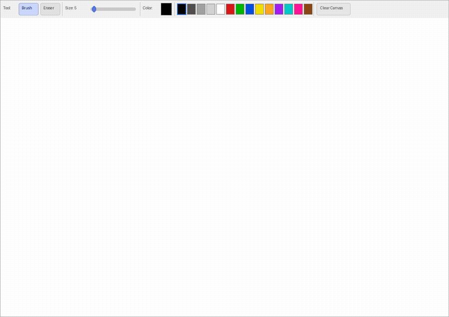

# RustPaint

A simple painting app built with Rust and [egui](https://github.com/emilk/egui) / [eframe](https://github.com/emilk/egui/tree/master/crates/eframe).



## Features

- **Brush** tool — left-click and drag to draw smooth strokes
- **Eraser** tool — erase back to white
- **Spray** tool — airbrush-style randomized paint dots
- **Flood Fill** tool — fill contiguous regions
- **Eyedropper** tool — pick colors from the canvas
- **Line** tool — draw straight strokes with independent thickness
- **Shape** tool — draw rectangles, ellipses, circles, triangles, diamonds, and pentagons
- **Crop** tool — select and crop the canvas
- **Text** tool — place bitmap text on the canvas
- **Color picker** — full RGB/HSV picker via the color button
- **36-color quick palette** — one-click color swatches
- **Recent colors** and **saved color slots**
- **Brush size** slider (1–50 px)
- **Undo / Redo** with bounded patch-based history
- **PNG open / save / save as**
- **Clear Canvas** button

## Build & Run

```sh
cargo run             # debug build
cargo run --release   # faster rendering
```

Requires a Rust toolchain (1.70+). Dependencies download automatically via Cargo.

## Controls

| Action | How |
|---|---|
| Draw / Erase | Left-click drag on the canvas |
| Spray | Hold left mouse button on the canvas |
| Fill / Eyedropper | Click a canvas pixel |
| Line / Shape / Crop | Click-drag from start to end |
| Text | Click, type, then press Enter or Escape |
| Pick a precise color | Click the color swatch in the toolbar |
| Quick color | Click any palette swatch |
| Save current color | Right-click a saved color slot |
| Resize brush | Drag the size slider |
| Resize line/shape stroke | Drag the line thickness slider |
| Switch tool | Click the tool buttons in the toolbar |
| Undo / Redo | Click buttons, Ctrl/Cmd+Z, Ctrl/Cmd+Shift+Z, or Ctrl/Cmd+Y |
| New canvas | Click **New** or press Ctrl/Cmd+N |
| Open / Save | Use **Open**, **Save**, or **Save As…** |
| Clear | Click **Clear Canvas** |

## Tech

- [`eframe 0.31`](https://crates.io/crates/eframe) — native window and event loop
- [`egui 0.31`](https://crates.io/crates/egui) — immediate-mode GUI + color picker
- Pixel buffer uploaded as a `ColorImage` texture each frame when modified
- Strokes interpolated with Bresenham's line algorithm so fast mouse movement leaves no gaps
- Undo/redo stores rectangular canvas patches instead of full snapshots for common operations
